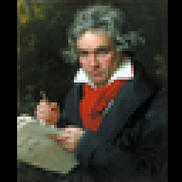
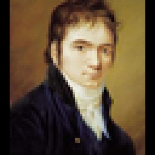
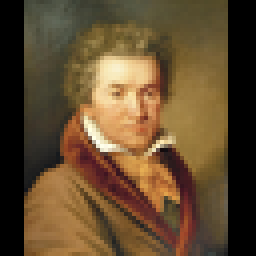
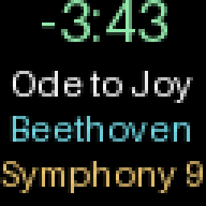
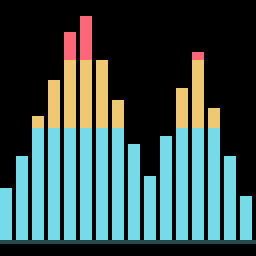
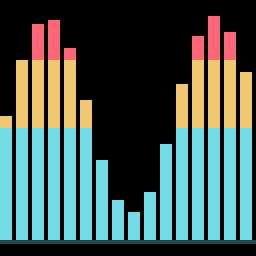

# HUB75 Album Artwork

A standalone Home Assistant app that displays Music Assistant album artwork,
song title, artist, album, and remaining playing time on a 64x64 HUB75 matrix
running WLED. No Dasher dependency, HA YAML automation, or manually created
Home Assistant token is required. Core playback pages need no Music Assistant
API token; optional artist photos use separate MA URL/token settings.
An optional YouTube video page uses unofficial yt-dlp extraction and FFmpeg
decoding on the HA host, with DDP output to WLED.

## Screens

Actual app-rendered 64x64 frames, enlarged four times without smoothing. These
are software previews, not photographs of a physical LED panel. The example
uses a designed sample album cover and public-domain Beethoven portraits;
your Music Assistant artwork replaces them during playback.

| Album cover | Artist image 1 |
| --- | --- |
|  |  |
| **Artist image 2** | **Artist image 3** |
|  |  |
| **Track information** | **Equalizer** |
|  |  |
| **Music paused** | **Equalizer animation** |
|  |  |

Playback order is cover, available artist images, track information, then
equalizer, then an available video. Artist images, the equalizer, and video are
optional; the gallery above illustrates the non-video pages. Long text scrolls;
the information preview captures the start of a scrolling row. The pause screen
appears for one minute before WLED turns off. The equalizer animation uses
illustrative spectrum values, not captured audio.

See [image sources and regeneration](docs/screenshots/README.md) for credits
and instructions for updating these previews.

## Requirements

- Home Assistant OS with Supervisor and the Music Assistant integration enabled.
- An amd64 or aarch64 host.
- WLED 16.0.1 or newer with HUB75 support and a configured 64x64 matrix.
- Network access from Home Assistant to the WLED controller.
- For the optional equalizer, a Music Assistant version with WLED Audio Sync
	and working multicast between Music Assistant and this app.
- For optional video: DDP output, internet access to YouTube, and enough HA-host
  CPU for FFmpeg decoding. FFmpeg, Node.js, and yt-dlp are bundled in the app.

## Install

Open **Settings > Apps > App store**
(called **Add-ons** on older HA versions), select **Repositories** from the menu,
and add:

```text
https://github.com/JannicSJensen/ha-hub75-app
```

Install **HUB75 Album Artwork**, set `display_url`, and start the app. The
Supervisor builds the image on your device; no external container registry is
required. Leave `player_entities` empty to follow any Music Assistant player.

For local installation before publishing, place the `hub75` folder in your HA
local app directory, conventionally `/addons/hub75` on the host. Refresh the app
store and install it from **Local apps**. The local apps directory is not the
Home Assistant `/config` directory; use Samba or an SSH app with access to it.

See [hub75/DOCS.md](hub75/DOCS.md) for settings and troubleshooting,
[docs/versioning.md](docs/versioning.md) for updates and releases, and
[docs/architecture.md](docs/architecture.md) for the implementation.

## Behavior

The app checks HA every five seconds and follows the most recently started
playing Music Assistant player that has artwork. Multiple independent players
share one display, so the most recent player takes precedence. If it stops,
another playing player takes over. Artwork changes cause a new upload; position
and volume updates do not.

The display alternates between two pages: a full-screen 64x64 album cover and
a track-information page with a large countdown, song title, artist, and album.
Each page stays visible for eight seconds by default; change `page_interval`
to adjust that duration. New songs start on the cover page. Long text scrolls
horizontally and continues across later information pages.

Enable `show_artist_images` to add up to three full-screen artist photos between
the cover and track information. Set `music_assistant_url` and
`music_assistant_token`, then choose `artist_image_count` from one to three.
Photos load in the background and are cached per artist. Missing or ambiguous
library artists and failed images are skipped; duplicate photos are not repeated.
See the [artist photo setup guide](hub75/DOCS.md#artist-photos).

Enable `show_equalizer` to add a page with 16 live spectrum bars. Set
`audio_sync_port` to the Music Assistant WLED Audio Sync zone's port (default
11988) and group that zone with the speaker being followed. The app receives
analysis data, not audio, and renders it at up to 20 FPS with DDP. No microphone
or Audio Reactive firmware is needed on the panel. See the
[Audio Sync setup guide](hub75/DOCS.md#equalizer-and-music-assistant-audio-sync).

Enable `show_video` with `output_protocol: ddp` to add a matching YouTube video
as the final page. The app searches the current artist/title, checks identity
and duration, and skips unavailable matches. FFmpeg decodes silent 64x64 frames
at 10 FPS by default; `video_fit` selects letterboxing or cropping, and
`video_offset` adjusts best-effort alignment to HA playback. Music-video intros
and edits may differ from the audio track. This is unofficial extraction, not
an endorsed YouTube integration, and may break when YouTube changes. Queries
send artist/title and your connection's IP address to YouTube. Use only content
you are authorized to access and comply with the applicable terms. No cookies,
login, DRM, age, or region bypass options are provided. See the
[video setup and limitations](hub75/DOCS.md#youtube-video-page).

The countdown advances every second on the information page using HA's playback
position timestamp between HA polls; live streams without a duration show
`--:--`. Disable `show_artist_images`, `show_track_info`, `show_equalizer`, and `show_video`
to show only the full-screen cover.

Use the `rotation` dropdown to rotate all pages clockwise by 0, 45, 90, 135,
or 180 degrees. The default is 0. Diagonal rotations are scaled to fit the
64x64 panel with black padding, keeping the entire image visible.

The `output_protocol` dropdown selects HTTP JSON (default) or native DDP.
HTTP sends initial frames as 16 sequential pixel requests and subsequent text
and countdown frames as changed chunks. DDP sends RGB24 frames over UDP port
4048, renders scrolling at up to ten frames per second, and resends static
images every half second. No additional integration is needed. Both modes
reuse the downloaded cover and preserve current brightness; DDP requires
WLED's **Force max brightness** setting to be disabled. See the
[DDP setup instructions](hub75/DOCS.md#choosing-the-output-protocol).

When all selected Music Assistant players
stop or pause, the display shows "music paused" for 60 seconds and then turns
WLED off. Resuming music cancels the timer and restores playback; resuming after
shutdown turns the display back on. This also works in cover-only mode.
Set `pause_then_off: false` to use the older `idle_action` behavior (`keep` or
immediate `off`) instead. Starting the app with no playing music does not take
over an independently controlled display.
While music is playing, a health check every 30 seconds restores artwork after a
WLED restart or a change to its current effect.

The app uses the Supervisor-provided token only for the HA API and HA artwork
proxy. It does not send that credential to WLED or external artwork hosts. Keep
WLED on a trusted LAN. Saved presets and playlists are not written or deleted.

## Development

```bash
python3 -m venv .venv
.venv/bin/pip install -r requirements-dev.txt
.venv/bin/python -m unittest discover -s tests -v
docker build -t ha-hub75-app:dev hub75
```

Install FFmpeg locally for the real decoder tests. The tests validate the HA
manifest and run against mock HTTP servers, generated video, and a local
UDP receiver, with no HA
credentials or physical display required. CI tests Python 3.13 and builds both
CPU architectures. The configured app version is `0.9.0`. The tests do not
contact YouTube or require a physical panel.