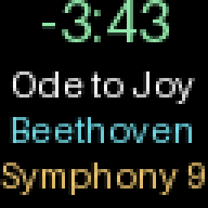

# Screen Previews

The [screen gallery](https://github.com/JannicSJensen/ha-hub75-app#screens)
shows the cover, three artist-image pages, track information, equalizer, and
pause screen. These are actual renderer outputs with example artwork and
illustrative spectrum data, enlarged from 64x64 without smoothing; they are
not photographs of a physical display.

| Track information | Paused before shutdown |
| --- | --- |
|  |  |

# Configuration

```yaml
display_url: http://192.168.2.214
output_protocol: http
player_entities: []
idle_action: keep
pause_then_off: true
show_track_info: true
show_artist_images: false
artist_image_count: 3
music_assistant_url: ""
music_assistant_token: ""
show_equalizer: false
audio_sync_port: 11988
audio_sync_interface: 0.0.0.0
show_video: false
video_fps: 10
video_fit: contain
video_offset: 0
page_interval: 8
rotation: "0"
refresh_interval: 5
log_level: info
```

| Option | Meaning |
| --- | --- |
| `display_url` | WLED controller base URL. Default is your wall_01 controller. |
| `output_protocol` | Dropdown: `http` (default) for JSON pixel uploads, or `ddp` for UDP frame streaming. Both use HTTP for setup and power control. |
| `player_entities` | Optional list of Music Assistant HA media-player IDs. Empty means all MA players. |
| `idle_action` | Used only when `pause_then_off` is `false`: `keep` leaves the last frame visible; `off` turns WLED off immediately. |
| `pause_then_off` | Show "music paused" for 60 seconds after playback stops, then switch WLED off. Default: `true`. Overrides `idle_action`. |
| `show_track_info` | Include the track-information page. Default: `true`. Disable all optional pages for an uninterrupted cover. |
| `show_artist_images` | Include up to three full-screen artist photos after the cover. Default: `false`. Requires MA URL/token settings. |
| `artist_image_count` | Maximum number of distinct artist photos, from 1 to 3. Default: `3`. Missing photos are skipped, not repeated. |
| `music_assistant_url` | Optional MA server base URL, for example `http://YOUR_MA_HOST:8095`. Use the direct server URL, not HA ingress or `/api`. |
| `music_assistant_token` | Optional MA access token for artist-library reads, entered in the password field. Not a HA or Supervisor token. |
| `show_equalizer` | Include a live 16-band spectrum page using Music Assistant's WLED Audio Sync data. Default: `false`. |
| `audio_sync_port` | UDP zone port matching the Music Assistant WLED Audio Sync provider. Default: `11988`. Not DDP's port 4048. |
| `audio_sync_interface` | HA host's local IPv4 address for joining the multicast group. `0.0.0.0` (default) selects the OS default interface. |
| `show_video` | Add an unofficial YouTube video page. Default: `false`. Requires `output_protocol: ddp`. No API key or MA token needed. |
| `video_fps` | Decoded video frames per second, from 5 to 20. Default: `10`. Lower this on slower HA hosts. |
| `video_fit` | `contain` (default) preserves the full picture with black padding; `cover` fills the panel and crops the edges. |
| `video_offset` | Video timing offset in seconds, -60 to 60. Default: `0`. Positive advances video; negative delays it, clamped at the beginning. |
| `page_interval` | Seconds each available page remains visible, from 3 to 60. Default: 8. Only the cover is shown when no optional pages are available. |
| `rotation` | Dropdown for clockwise rotation: `0`, `45`, `90`, `135`, or `180` degrees. Default: `0`. Applies to every page. |
| `refresh_interval` | Seconds between HA checks, from 1 to 60. Default: 5. |
| `log_level` | `debug`, `info`, `warning`, or `error`. Default: `info`. |

Save options and restart the app to apply changes. Home Assistant Core does not
need a restart. The app uses its automatically supplied Supervisor token.

## Choosing Players

Use the entity created by the **Music Assistant integration**, not the underlying
Cast, AirPlay, or speaker entity. Music Assistant entities expose
`app_id: music_assistant`, `state: playing`, and `entity_picture` while playing.
Group players are supported. For example, to follow only the kitchen player:

```yaml
player_entities:
  - media_player.sound_mad_01
```

With multiple players, the one whose state most recently changed to `playing`
wins. Players without artwork are skipped for cover selection, but still count
as playing so a temporary missing cover does not trigger a pause screen. The
app does not start, pause, or change music playback.

## Pause and Shutdown

With `pause_then_off: true`, once all selected Music Assistant players stop,
pause, or become idle, the app displays "music paused" centered on two lines.
The 60-second timer starts after the screen uploads successfully. It then sends
WLED `on: false`. Repeated idle updates do not restart the timer or wake the
display after shutdown. This behavior also works with `show_track_info: false`.

Resuming any selected player cancels the timer and restores the playing display
starting with the cover page. Resuming after shutdown turns WLED back on. If
another selected player is still playing, its cover takes over instead of
showing the pause message. Playback changes are detected on the next HA poll.

Starting the app while music is already idle does not take over or turn off an
unrelated WLED display. The pause timer is in memory and is canceled by an app
restart. Failed screen uploads and power-off requests are retried; power-off
failures do not restart the one-minute countdown. If HA cannot be reached at
the deadline, the app retries rather than turning off without checking whether
playback has resumed.

Updating from 0.3.0 enables this behavior by default, even if `idle_action` was
previously `keep`. Set `pause_then_off: false` and restart the app to retain the
old `idle_action` behavior.

## Artist Photos

Enable `show_artist_images` to rotate through **album cover > artist photo 1 >
artist photo 2 > artist photo 3 > track information > equalizer > video > album cover**.
Only enabled and available pages are included. Set `artist_image_count: 2` for
at most two photo pages, or `3` for at most three. If only one distinct photo is
available, it appears once. Each page uses `page_interval` and the configured
rotation. Photos preserve their aspect ratio with black padding like the cover.

Create an access token in Music Assistant's Profile settings and enter it
directly in this app's `music_assistant_token` password field. Give the token
artist/library read access if your MA version supports scoped tokens. Set
`music_assistant_url` to that server's reachable base URL, save, and restart.
Do not put the token in a URL or share it in logs. Existing HA-based cover and
track pages continue to work without these settings.

The app looks for a unique case-insensitive exact match to HA's `media_artist`
in the MA library and fetches its full artist metadata. Artists must be present
in that library with usable thumbnail, fanart, or landscape artwork. Logos are
excluded. Multiple artists in one combined metadata string, ambiguous names,
missing artwork, or artists not in the library are skipped rather than guessed.
The app does not search stock photos or require a third-party image service.

Photos load in a background task while other pages continue. It tries subsequent
images after a failed download and removes duplicate URLs and identical rendered
photos. Images are constrained by the same size limits as album covers. Up to
32 artists are cached in memory: successful results for one hour and empty/failed
lookups for five minutes. Tracks by the same artist reuse those photos. Restarting
clears the cache. Changing artists clears the previous photo pages and cancels
an old lookup; pausing and stopping retain the existing pause-then-off behavior.
When a new set of photos arrives, the page cycle restarts on the cover.

The MA token is used only for MA API and MA-proxied image requests. Public image
hosts receive no MA token, and neither MA nor external hosts receive the
Supervisor token. Missing credentials skip photo pages and are reported at
startup without preventing cover, information, or equalizer pages.

## Track Information

The display alternates between a full-screen album cover and a separate
information page. Each page remains visible for `page_interval` seconds. The
information page shows a large remaining-time countdown in green at the top,
then the song title in white, artist in cyan, and album in gold. Text lines that
do not fit scroll horizontally, starting after a two-second reading pause on
the first information page. Scrolling continues across later information pages
so long titles can be read in full. Each row is clipped to its own area.

New songs and player changes start the cycle on the cover page. The countdown
uses the current playback position when the information page reappears, rather
than resuming an old timer value from before the cover page.

Remaining time is calculated from `media_duration`, `media_position`, and
`media_position_updated_at`. The app advances the countdown once per second
between HA polls, then resynchronizes when HA supplies a new position. Seeking
or changing tracks is reflected on the next HA poll. The countdown stops at
`-0:00`; live streams and unknown durations show `--:--`. Missing metadata leaves
its corresponding line blank. When playback stops, the pause screen replaces
these pages by default. With `pause_then_off: false` and `idle_action: keep`, the
last rendered frame stays visible, including its last countdown value.

Updating from 0.2.0 replaces the compact layout with these two pages. Set
`show_artist_images: false`, `show_track_info: false`, `show_equalizer: false`, and
`show_video: false`, then restart the app
for an uninterrupted 64x64 cover.
The HA polling
interval still defaults to five seconds; the text/countdown render loop runs
separately. HTTP renders once per second and only uploads changed pixel chunks.
DDP renders up to ten times per second, or twenty with the equalizer enabled,
and sends complete frames when pixels change. The countdown still shows whole seconds.

## Equalizer and Music Assistant Audio Sync

[Music Assistant PR #5537](https://github.com/music-assistant/server/pull/5537)
is merged into its development branch. Use a Music Assistant version that
includes the **WLED Audio Sync** provider. This sends analysis features, not
playable audio or image pixels. The app renders the received 16 spectrum bands
as a visual equalizer; it does not change audio frequencies or volume.

1. Add a WLED Audio Sync provider/zone in Music Assistant. Note its UDP port,
  normally `11988`; additional zones may use different ports.
2. Group that zone's virtual player with the real speaker/player group whose
  music should drive the visualization, following Music Assistant's setup.
3. In this app, set `show_equalizer: true` and `audio_sync_port` to that zone's
  port. Choose `output_protocol: ddp` for smoother animation.
4. Restrict `player_entities` to the MA speaker/group associated with that zone
  so the cover and spectrum represent the same music.
5. Save and restart the app. Configure WLED for DDP as described below.

With artist photos disabled and both other optional pages enabled, the cycle is
**cover > track information > equalizer > cover**, with `page_interval` applying
to each page. Artist photos, when enabled and available, come after the cover. Disabling
`show_track_info` gives **cover > equalizer > cover**. Rotation applies to the
equalizer as well. Silence shows empty bars, not simulated audio. While the
equalizer page is rendering, missing or invalid packets clear the bars after
two seconds. New songs clear old spectrum data and restart on the cover page.
The default pause screen still replaces all playback pages when music stops.

The app joins multicast **239.0.0.1** on `audio_sync_port`. Host networking is
enabled in the app manifest so it can receive LAN multicast, including packets
from Music Assistant on the same HA host. The UDP listener is opened only when
`show_equalizer` is enabled and is closed on app shutdown. If automatic interface
selection fails, set `audio_sync_interface` to the HA host's LAN IPv4 address,
not the WLED controller's address. Multicast must be allowed by the network;
different VLANs require multicast routing. Audio Sync is unauthenticated, so use
it only on a trusted LAN.

This is the same zone-port concept as WLED's **audioSyncPort**, but our app is
the receiver. You do not need to enable Audio Sync reception on the panel or
install an Audio Reactive usermod/microphone for this renderer. DDP on **4048**
is the separate outgoing pixel transport. Do not run competing pixel senders
or native audio-reactive effects on the same panel while the app controls it.

Music Assistant sends up to 40 analysis packets per second. DDP rendering uses
the latest received bands at up to 20 FPS; HTTP renders about once per second
and is not recommended for responsive equalizers. Packet delivery, rendering,
and slow HA requests can introduce latency. The 44-byte packet has no player
identifier or playback timestamp, so the app cannot automatically select the
correct room's audio or guarantee sample-perfect synchronization. Use matching
zones and tune the Music Assistant provider's latency setting against the real
speaker output. No audio stream is captured by this app.

## YouTube Video Page

1. Update the app to **0.9.0** or newer and configure WLED for DDP below.
2. Set `output_protocol: ddp` and `show_video: true`. Video is not supported by
  the HTTP pixel uploader; enabling video with HTTP prevents startup with a
  configuration error.
3. Start with `video_fps: 10`, `video_fit: contain`, and `video_offset: 0`.
  Save and restart the app. HA Core does not need a restart.

```yaml
output_protocol: ddp
show_video: true
video_fps: 10
video_fit: contain
video_offset: 0
```

Available pages rotate through **cover > artist photos > track information >
equalizer > video > cover**, omitting disabled or missing pages. `page_interval`
applies to video too. Decoding continues while other pages are visible, so the
video resumes at the current song position rather than restarting on each flip.
When video becomes available or disappears, the cycle restarts at the cover.
Shared clockwise rotation applies to every decoded frame.

The app uses HA's artist/title to search up to five YouTube results and tries up
to three conservative matches. Title words and artist identity must match;
obvious covers, live versions, remixes, and similar alternate versions are
rejected unless requested by the song metadata. When durations are known, a
difference above 30 seconds or 15% of the audio duration, whichever is larger,
is rejected. This is heuristic matching, not a guarantee of the correct video.
Ambiguous collaborations, unusual titles, and songs without artist/title may
have no video. There is no manual URL override.

FFmpeg runs inside the app on the HA host. It reads a low-resolution direct
HTTPS video stream, emits RGB24 frames, and never plays YouTube audio. WLED
receives only pixels through UDP 4048; it does not decode MP4. Only direct HTTPS
video formats at or below 360p are selected, so some otherwise playable YouTube
videos are unavailable. No complete video is saved to disk. A 16:9 picture is
normally about 64x36 with black padding in `contain` mode; `cover` fills 64x64
by cropping. At 20 FPS, RGB payload alone is about 2 Mbit/s, plus packet overhead.
Video decoding consumes CPU even while the video page is not visible. Lower
`video_fps` if animation stutters or the HA host is overloaded.

Timing extrapolates HA's `media_position` and `media_position_updated_at`.
Seeks are picked up on the next HA poll and trigger decoder reseeking when the
timing differs by more than two seconds. `video_offset: 5` advances the video
five seconds; `-5` delays it. Stream buffering, unknown playback positions,
speaker latency, and music-video intros/edits prevent frame-perfect sync. The
app does not control, pause, or delay Music Assistant audio.

Search and decoding run in background tasks, with asynchronous HA polling in
video mode. Other pages continue during lookup and slow HA requests. Frames
older than two seconds are excluded from the cycle. Lookup is bounded to 90
seconds overall, and a stalled frame read times out after 15 seconds. Failures
back off for five minutes. Up to 32 matching IDs are cached for 24 hours;
unmatched lookups are cached for five minutes. Signed stream URLs are resolved
again when a worker starts, not stored for long-term reuse. Restart clears the
cache. Normal end-of-video skips that page for the rest of the track.

Player/track changes, pause, idle, and app shutdown cancel the worker and stop
FFmpeg/yt-dlp. The existing one-minute pause screen and WLED shutdown still
apply. An expired pause timer waits for a fresh HA state before turning off.
Starting while idle does not search YouTube or take over WLED.

### Privacy and Service Limitations

This feature is disabled by default and uses **unofficial yt-dlp extraction**,
not YouTube's supported embedded-player or Data API integration. YouTube may
block requests or change extraction/challenge requirements without notice.
Future fixes require an app release; dependencies are not auto-updated while
the app runs. Unavailable videos simply leave the other pages in the cycle.

Enabling it sends artist/title searches, video requests, and your connection's
public IP address to YouTube/Google. HA and MA tokens are not supplied to
yt-dlp, FFmpeg, or YouTube. No API key, cookies, login, DRM, age, or geographical
restriction bypass settings are included. Only use content you are authorized
to access and comply with applicable service terms and local law. YouTube's
terms and developer policies can restrict extraction outside supported players;
the feature is not endorsed by YouTube and does not establish permission to
download or display content.

If no video appears, check app logs for a matched/unavailable message, artist
and title metadata, internet access, the DDP setting, and extraction failures.
The logs deliberately omit signed stream URLs and extractor stderr. Try a
different track after a failed lookup, or wait five minutes. Falling back to
other pages is expected when no suitable stream can be obtained.

## Choosing the Output Protocol

Keep `output_protocol: http` for the existing acknowledged JSON uploader.
Choose `ddp` in the Configuration tab, save, and restart the app to stream RGB24
pixels directly to the controller over UDP port **4048**. No HACS integration
or additional HA automation is required. Use the controller's direct LAN URL;
DDP targets the hostname in `display_url`, not an HTTP proxy or ingress URL.
Allow UDP 4048 from the app to WLED as well as the existing HTTP connection.
DDP is not WLED's separate UDP notifier/sync-group protocol.

Before selecting DDP, open WLED **Config > Sync Interfaces** and ensure:

- Realtime data reception is enabled.
- Realtime LED mapping is enabled, so the existing matrix mapping is respected.
- **Force max brightness** is disabled. The app refuses DDP if it is enabled.
- The realtime LED offset is zero.
- The realtime timeout is at least one second; the normal 2.5-second value works.

The app reads these settings but never changes or saves them. DDP's appearance
also depends on WLED's realtime gamma setting. There is no automatic gamma,
contrast, sharpening, or brightness adjustment; both transports carry the same
rendered RGB pixels. If colors look different, check WLED's realtime gamma
setting rather than assuming DDP improves image quality.

A complete 64x64 frame uses nine UDP packets. Only the final packet requests
displaying the frame. UDP has no delivery acknowledgement; packet loss may
briefly show incomplete frames. Static covers, the last frame in `idle_action:
keep`, and pause screens are resent every half second. A dedicated resend task
continues while HA polling or artwork downloads are waiting. Only one sender
writes packets at a time, and resends use the latest completed frame.

DDP streaming continues throughout the pause minute. At its end the app cancels
the resend task, closes the UDP socket, and sends HTTP `live: false` and `on:
false`. No further packets are sent until playback resumes. A successful UDP
send means the local network accepted the packets, not that WLED acknowledged
the image; HTTP control failures and local send failures are retried.

## WLED Setup

Select `rotation` in the Configuration tab, save, and restart the app to change
the display orientation. Rotation applies after composing each page, including
the album cover, countdown, metadata, and "music paused" screen. A 90- or
180-degree rotation preserves pixel detail. At 45 or 135 degrees, the expanded
image is scaled down to fit the 64x64 panel with black padding; nothing is
cropped, but text and artwork become smaller. This rotates the display content,
not the physical HUB75 wiring, and does not mirror the image.

Use a HUB75 build of WLED 16.0.1 or newer. Configure the physical panel as 64x64
and set the 2D matrix size to 64x64. Use one segment for the display. The app
configures segment 0 to cover the entire matrix and clears segment mirroring,
rotation, grouping, spacing, and offset. HTTP replaces the running effect with a
frozen pixel image; DDP uses realtime mode. Neither modifies saved presets.

Brightness is not raised by the app. Set it in WLED or with `light.wall_01` in
Home Assistant. A brightness of zero, or a segment brightness of zero, produces
a dark image. HUB75 panels need a properly sized independent 5V supply; WLED's
automatic current limiter does not account for HUB75 power consumption.

The app turns the display on when uploading a cover. While music is playing,
turning it off or selecting another effect may be undone by the next health
check within 30 seconds. Stop the app to control WLED independently. In HTTP
mode stopping leaves the frozen image as it is. In DDP mode stopping releases
realtime mode and WLED returns to its underlying effect; the streamed image is
not persisted. `idle_action` applies to playback, not to app shutdown. Pixel
images are not persistent across controller restarts, but
the app restores the cover if music is still playing.

## Troubleshooting

- **No cover:** verify the MA integration exposes artwork and the correct player
  is `playing`. Check `player_entities`; an empty list follows all MA players.
- **No artist photos:** enable `show_artist_images`, configure the MA URL/token,
  and check that the artist name matches one MA library artist with usable images.
  Failed lookups are cached for five minutes; restart after correcting settings.
- **HTTP 401/403:** stop and start the app to obtain its Supervisor token. No
  long-lived user token should be configured.
- **HTTP 404:** the HA media proxy may be temporarily unavailable during a track
  change. The app retries on the next polling cycle.
- **Matrix-size error:** correct WLED's 2D configuration; only 64x64 is supported.
- **Connection failures:** check the controller URL and LAN reachability from HA.
- **DDP configuration error:** follow the realtime settings above; unsafe brightness
  settings are rejected before the app turns the controller on.
- **DDP shows nothing or flickers:** allow UDP 4048, check realtime overrides and
  matrix mapping, and stop competing realtime senders. UDP send success does
  not confirm delivery. Select `http` and restart for an acknowledged fallback.
- **Equalizer is empty:** confirm the WLED Audio Sync provider exists in your
  Music Assistant version, its virtual zone is grouped with a playing speaker,
  and the app's port matches. Check multicast/firewall and interface selection.
- **Equalizer follows another room or seems early/late:** select the correct
  zone port and matching `player_entities`, then tune MA's latency setting.
- **Scrambled display:** check the HUB75 panel's scan rate and WLED wiring setup.
- **Wrong cover:** restrict `player_entities` when independent rooms play music.

The Logs tab reports successful uploads and retryable failures. Failed downloads
do not change the display, and failed uploads are retried rather than cached.
Images above 10 MiB or unsafe decoded dimensions are rejected. Debug logs can
contain temporary artwork URLs; redact them before sharing logs.