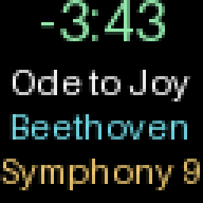
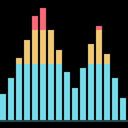

# HUB75 Album Artwork

## Screen Previews

Software previews from the actual 64x64 renderer, enlarged without smoothing;
not photographs of the panel. Artwork and track details are examples.

| Album cover | Track information | Equalizer |
| --- | --- | --- |
|  |  |  |

See the [complete screen gallery](https://github.com/JannicSJensen/ha-hub75-app#screens)
for artist images, the pause screen, an equalizer animation, and image credits.

## Overview

Display Music Assistant album covers on a WLED 64x64 HUB75 matrix. The app
automatically follows playing Music Assistant media players and preserves the
display's current brightness. A full-screen cover alternates with a separate
page showing scrolling song title, artist, album, and a large live countdown.
Each page is visible for eight seconds by default; configure `page_interval`
to change this. Disable all optional pages for an uninterrupted album cover.

Enable `show_artist_images` for up to three full-screen artist photos after the
cover. Configure the MA server URL and token, then set `artist_image_count` to
one, two, or three. Available photos are cached; missing and duplicate photos
are skipped. The rotation is cover, artist photos, track information, equalizer.

When music stops or pauses, the app displays "music paused" for one minute,
then turns WLED off. Resuming music cancels the shutdown and restores the cover.

Use the `rotation` dropdown to rotate the entire display clockwise by 0, 45,
90, 135, or 180 degrees. Save the configuration and restart the app to apply it.

Choose `output_protocol: http` (default) or `ddp` in the Configuration tab.
DDP streams directly over UDP 4048, supports smoother scrolling, and resends
static images automatically. Disable WLED's Force max brightness setting before
using DDP. Both modes support every page, rotation, and pause-then-off behavior.
No separate HACS integration is required.

Enable `show_equalizer` to add a live 16-band spectrum page. Set
`audio_sync_port` to your Music Assistant WLED Audio Sync zone's port, normally
11988, and group that zone with the speaker whose music should drive the bars.
DDP supports up to 20 FPS; HTTP is slower. The app receives multicast analysis
data and does not require a microphone or Audio Reactive firmware on the panel.

Set the controller's URL in the Configuration tab, then start the app. There is
no separate web interface or Home Assistant automation to configure.

Read the Documentation tab for configuration, display behavior, and troubleshooting.